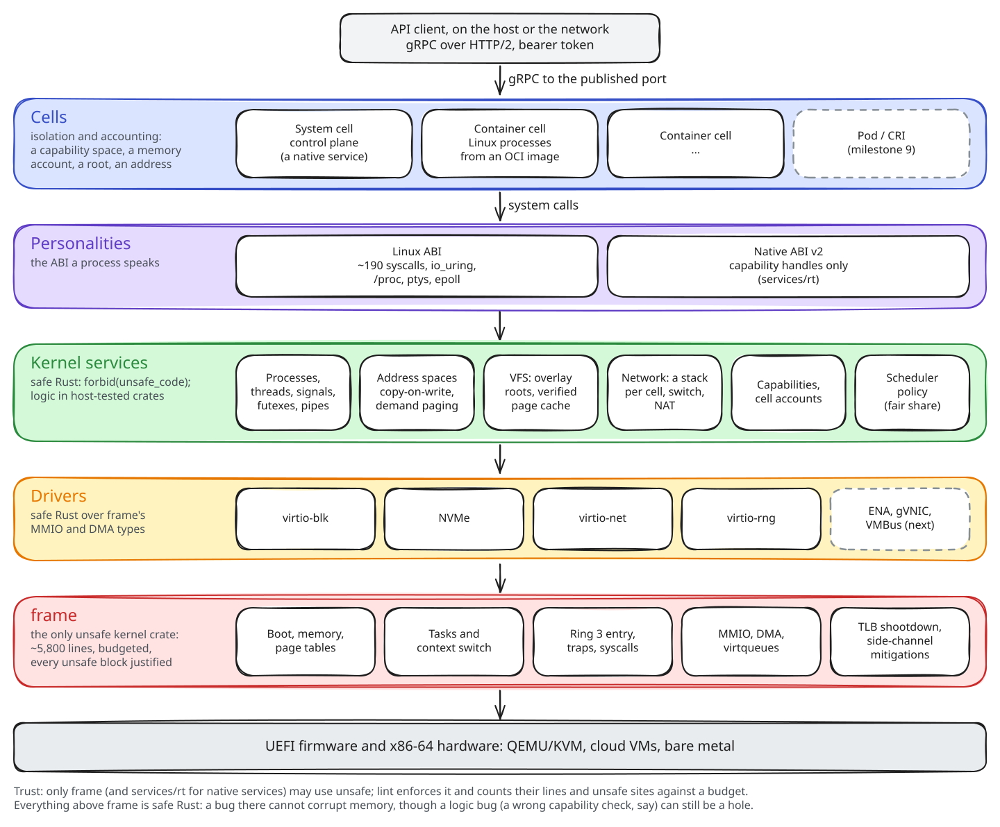
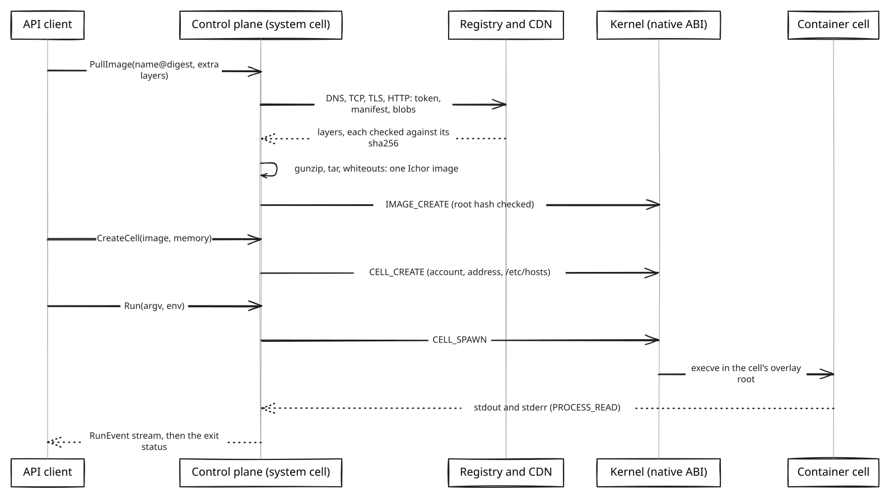
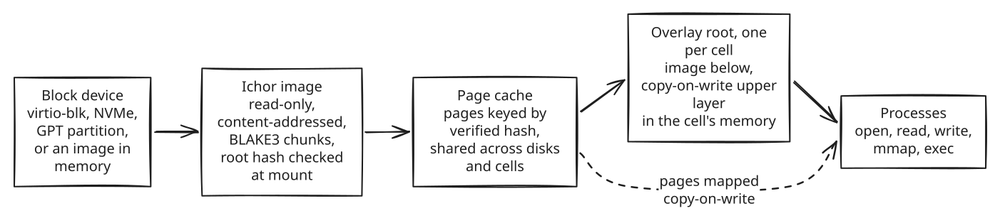
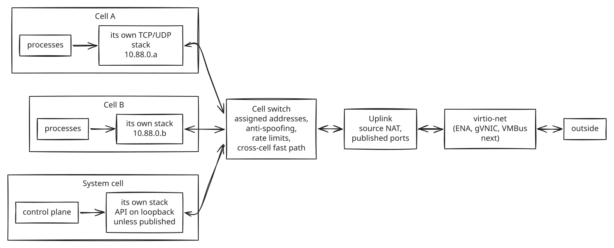

# Ichor's architecture

Ichor is a server OS in Rust that runs OCI containers natively: a
container's Linux binaries run directly on Ichor's own kernel, which
implements the Linux system-call ABI. There is no Linux kernel underneath,
and no VM per container. The design decisions behind each part are in
`docs/adr/`; this page is the map.

The diagrams' sources are next to their renderings in `docs/architecture/`.
The `.excalidraw` files open in [excalidraw.com](https://excalidraw.com).
The `.mmd` files are Mermaid, converted with the Excalidraw CLI
(`excalidraw mermaid X.mmd --out X.excalidraw`, then `excalidraw render`).

## Layers

From the bottom up:

- **frame** (`kernel/frame`) is the trusted computing base, and the only
  kernel crate allowed `unsafe` (ADR-0001). It owns everything that has
  to touch hardware or memory directly: UEFI boot, the page allocator and
  page tables, ring-3 entry and exit, tasks and context switching,
  interrupts, PCI MMIO and DMA buffers, TLB shootdown, and the
  side-channel mitigations (ADR-0004). It exposes an API that must be
  sound for *any* safe caller. Its size is a tracked budget: about 5,800
  lines and 250 unsafe sites today, counted by `cargo xtask frame-audit`
  and enforced by lint.
- **Drivers** (`kernel/drivers/*`) are safe Rust over frame's `IoMem`,
  `DmaBuf` and `VirtQueue`: virtio-blk, NVMe, virtio-net, virtio-rng.
- **Kernel services** (`kernel/ichor` plus pure-logic crates) are safe
  Rust with `#![forbid(unsafe_code)]`. Anything that does not touch
  hardware lives in its own host-testable crate (`cap`, `cell`, `sched`,
  `vma`, `overlay`, `image`, `net`, `uring`, `elf`, ...), tested with
  `cargo test` and fuzzed where it parses untrusted input.
- **Personalities** are the system-call ABIs a process can speak. The
  Linux ABI (`kernel/ichor/src/linuxabi*`) runs unmodified Linux
  binaries. The native ABI (`docs/abi/native.md`) is Ichor's own
  capability interface, used by Ichor's services (`services/*`, with
  `services/rt` their runtime).
- **Cells** are the unit of isolation and accounting (ADR-0002): a
  capability space, a memory account, a root filesystem and a network
  address. A container is a cell. The *system cell* runs the control
  plane, a native service embedded in the kernel image.

## Running a container

The control plane (`services/control`) serves `ichor.v1.Control`
(`docs/abi/control.proto`) over gRPC. Pulling an image uses Ichor's own
DNS, TCP, TLS 1.2/1.3, HTTP/1.1 and HTTP/2 crates; every layer is checked
against its digest, then converted into one Ichor image. The kernel
verifies the image's root hash, makes a cell over it, and runs the
program's `execve` inside the cell. Output streams back to the client as
`RunEvent`s.

## Storage

An Ichor image is read-only and content-addressed: BLAKE3 hashes for every
chunk, and a root hash checked at mount (ADR-0006). The page cache keys
pages by their verified hash, so identical files share memory across
images and cells. Each cell's root is an overlay: the image below, and a
copy-on-write upper layer in the cell's own memory.

## Networking

Every cell has its own TCP/UDP stack (`kernel/net`, sans-I/O and
host-tested), so cells share no sockets, ports or connection tables.
Cells meet at an in-kernel switch, which assigns addresses, stops
spoofing, limits rates and short-cuts traffic between cells. At the
uplink, source NAT and published ports connect cells to the outside
(ADR-0010).

## How extensible it is

Ichor is built to grow in the places a container OS needs to grow, and
deliberately rigid in the trusted core.

**Easy to extend:**

- **Linux system calls.** A syscall is a constant (whose comment states
  how complete it is), a dispatch arm, and a self-test. `docs/linux-abi.md`
  is generated from the constants, and lint fails when a stub is listed as
  implemented. Real workloads decide what comes next: the CPython suite
  added about 40 calls in one milestone.
- **Native services.** A new service is a crate in `services/` built for
  `x86_64-unknown-none`, embedded in the kernel image, and run in a cell
  with only the capability handles it is given. The control plane is one
  such service. Services are safe Rust over `services/rt`.
- **Drivers.** A driver is a safe crate over frame's PCI, MMIO and DMA
  types, with no new `unsafe`. Cloud NICs (ENA, gVNIC) and Hyper-V VMBus
  are the next ones.
- **The control API.** It is protobuf over gRPC, so new calls are new
  messages and a new handler in the control plane.
- **Policy.** The scheduler's policy is a host-tested crate injected into
  frame's mechanism (`kernel/sched`). Mitigations, NAT timeouts, limits and
  similar choices sit in safe code.
- **Testing.** A QEMU boot test is one call (`ichor_tests::boot`) and a set
  of serial markers. Ring-3 self-tests are tiny programs built with
  `kernel/testprog`. Real suites run through the API with
  `cargo xtask workloads`.

**Deliberately hard to extend:**

- **frame.** Adding to the trusted core needs a reason. Growing its budget
  takes an ADR, and every `unsafe` block carries a justification.
- **No loadable modules.** Everything is compiled into one image, and there
  is no eBPF-style in-kernel extension. Extensions are services in cells,
  not code in the kernel.
- **One architecture.** Only x86-64 exists today. Another architecture
  needs a new `frame/src/arch/*` and drivers. The safe layers above
  frame are written against frame's API, not against x86.

**Not built yet, and where it would go:** Kubernetes CRI (milestone 9)
would be another native service, or the control API extended. Writable
shared file mappings need the overlay to keep file pages as frames.
Per-process CPU scheduling weights (nice, affinity) need the scheduler
policy to take them.
